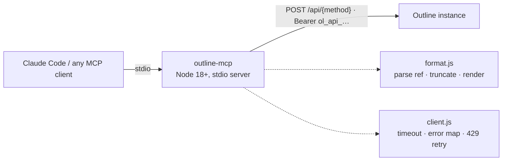

# outline-mcp-js

[MCP](https://modelcontextprotocol.io) server for
[Outline](https://www.getoutline.com). Gives an agent search and read access
to your wiki — no writes, by design.

[](LICENSE)
[](https://nodejs.org)

## Why

Outline's API is a flat RPC surface — every endpoint is
`POST {base}/api/<method>` with a JSON body and a Bearer token. That uniformity
means a useful MCP server is a single request function plus a curated tool
list. This package is deliberately small: no runtime
dependency beyond the MCP SDK and zod, and full control over the tool
descriptions and output shaping that determine whether the agent picks the
right tool.

The server can read and write: besides the read tools it has `create_document`,
`update_document`, `move_document`, `archive_document` and `delete_document`
(delete goes to the trash and is never permanent). What it may do is bounded by
the API key's own permissions. Set `OUTLINE_WRITE_DOC_ID` to confine every write
to `update_document` on that one document.

## Tools

| Tool | Outline method | Use it for |
|---|---|---|
| `search_documents` | `documents.search` | Full-text search; returns snippets, not bodies |
| `search_document_titles` | `documents.search_titles` | Locate a page you can already almost name |
| `get_document` | `documents.info` | Read one document as markdown |
| `list_collections` | `collections.list` | Find `collectionId` values to scope by |
| `list_documents` | `documents.list` | Browse a collection or a document's children |
| `list_revisions` | `revisions.list` | See how a document changed over time |
| `get_revision` | `revisions.info` | Read one earlier version |
| `list_comments` | `comments.list` | Reviewer pushback not present in the body |

`get_document` accepts a full URL, a bare `urlId`, or a UUID. A `urlId` is
`[A-Za-z0-9]{10,15}` — a slug without a valid id suffix is rejected locally,
because the API answers `400 validation_error` for it.

## Requirements

- Node 18 or newer (uses the built-in `fetch`; no native dependencies).
- An Outline instance — self-hosted or [Outline.com](https://www.getoutline.com).

## Getting started

```bash
git clone https://github.com/minhquan2904/outline-mcp-js.git
cd outline-mcp-js
npm ci
```

### Get an API key

In Outline: **Settings → API & Apps → New API key**. The value starts with
`ol_api_` followed by 38 alphanumeric characters.

### Set the two environment variables

```bash
export OUTLINE_API_URL=https://your-outline-instance
export OUTLINE_API_KEY=ol_api_…
node index.js
```

## Configuration

The server reads exactly two environment variables:

| Variable | Meaning |
|---|---|
| `OUTLINE_API_URL` | Base URL of your Outline instance, e.g. `https://your-outline-instance` (a trailing `/api` is tolerated) |
| `OUTLINE_API_KEY` | An Outline API key (`ol_api_…`) |

**Claude Code** — `mcp.json` (project) or `.mcp.json` (user):

```json
{
  "mcpServers": {
    "outline": {
      "command": "node",
      "args": ["/path/to/outline-mcp-js/index.js"],
      "env": {
        "OUTLINE_API_URL": "https://your-outline-instance",
        "OUTLINE_API_KEY": "ol_api_…"
      }
    }
  }
}
```

**Claude Desktop** — `claude_desktop_config.json`:

```json
{
  "mcpServers": {
    "outline": {
      "command": "node",
      "args": ["/path/to/outline-mcp-js/index.js"],
      "env": {
        "OUTLINE_API_URL": "https://your-outline-instance",
        "OUTLINE_API_KEY": "ol_api_…"
      }
    }
  }
}
```

**Note:** Claude Desktop does **not** expand `${VAR}` references in this file
— paste the key literally, do not write `"${OUTLINE_API_KEY}"`.

**Any other MCP client** (Zed, Cline, or anything speaking the MCP stdio
protocol) — same shape: launch `node /path/to/outline-mcp-js/index.js` with the
two variables in its environment.

## How it works



The server never validates credentials at startup. A server that exits on boot
appears in the client as "failed to connect" with no explanation; instead it
starts, lists its tools, and each call returns a message naming the missing
variable.

## Development

```bash
npm ci
npm test          # unit tests, fully offline (fetch is stubbed)
npm run smoke     # every tool against a real instance; no-ops without credentials
```

`npm run smoke` requires `OUTLINE_API_URL` + `OUTLINE_API_KEY` pointing at a
live instance; without them it prints a "smoke skipped" line and exits 0.
See [CONTRIBUTING.md](CONTRIBUTING.md) for how to add a tool.

## Benchmark

The three servers (JS, Go, Python) expose the same tools and return byte-identical output; this was
checked on every operation below. Numbers are per MCP tool call over stdio against a local mock of the
Outline API with realistic payloads, 200 timed calls per operation after warm-up, on one 4-CPU machine.
Method, harness and raw results: [benchmark/](https://github.com/minhquan2904/outline-mcp-js/tree/main/benchmark).

| Operation (p50 ms) | JS | Go | Python |
|---|---:|---:|---:|
| get_document (small page) | 0.62 | 0.14 | 1.45 |
| get_document (200 KB page) | 3.68 | 7.58 | 3.97 |
| search_documents (10 hits) | 0.59 | 0.34 | 1.89 |
| search_document_titles (15) | 0.59 | 0.21 | 1.60 |
| list_documents (25) | 0.58 | 0.27 | 1.72 |
| list_revisions (10) | 0.44 | 0.17 | 1.58 |
| list_comments (25) | 0.53 | 0.18 | 1.57 |
| update_document (append) | 0.47 | 0.15 | 1.70 |

| Resource | JS | Go | Python |
|---|---:|---:|---:|
| Startup to `initialize` (ms, median) | 91 | 2 | 513 |
| RSS idle (MB) | 71 | 8 | 64 |
| RSS peak after the run (MB) | 246 | 40 | 102 |
| 200 KB page, 16 in flight (req/s) | 113 | 394 | 343 |
| On disk | 26 MB `node_modules` + Node | 7.8 MB static binary | 76 MB virtualenv |

| Real instance, one page (p50 ms, n=10) | JS | Go | Python |
|---|---:|---:|---:|
| get_document | 36 | 23 | 29 |
| list_revisions | 29 | 23 | 30 |
| list_comments | 26 | 22 | 27 |
| update_document (append) | 45 | 40 | 46 |

What it means:

- On small calls Go is 2-4x faster than JS and 5-10x faster than Python, but that is 0.1-0.3 ms vs
  0.4-0.6 ms vs 1.4-1.9 ms. Against a real Outline instance (20-45 ms per call, last table) the server's own cost is lost
  in the network time, and the three are indistinguishable.
- Go starts in 2 ms and idles at 8 MB, against about 90 ms / 70 MB for Node and 510 ms / 64 MB for Python.
  That matters if a client launches the server per session.
- On the 200 KB page JS and Python (about 4 ms) beat Go (7.6 ms): Go decodes into generic maps and counts
  characters as runes. Under 16 concurrent requests Go and Python hold 340-390 req/s, while Node, which is
  single-threaded, drops to about 113.
- Peak memory under large pages: Go 40 MB, Python 102 MB, JS 246 MB.

Limits: single run, one machine, mock server in Python (see the caveats in `benchmark/README.md`).
The real-instance table uses only 10 calls per cell, so read it as "same ballpark", not as a ranking.

## Limitations

- **Document writes only.** There is no comment writing. Writes are bounded by the API key,
  and `OUTLINE_WRITE_DOC_ID` can confine them to one document.
- **Attachments are not resolved.** Embedded images and files stay as
  `/api/attachments.redirect?id=…` links in the markdown; they will not load for
  an agent reading the text.
- **No proactive rate-limit signal.** The instance does not return `RateLimit-*`
  headers. On a `429` the client honours `Retry-After` (capped at 10s) and
  retries exactly once, then reports the failure.
- Long documents are truncated at `maxChars` (default 40 000) with a marker
  stating the true total length.

## Security

The API key travels only in the `Authorization` header of outgoing requests.
Any error message that leaves the client is passed through a redaction step
that replaces the key with `ol_api_***`, and nothing on the key's path (the
stdio transport or the stderr log) ever prints the key itself. If your Outline
instance supports scoped keys, give this server the narrowest scope that fits: the
key's permissions are the real limit on what the write tools can do.

## License

[MIT](LICENSE) — see [LICENSE](LICENSE) for the full text.
