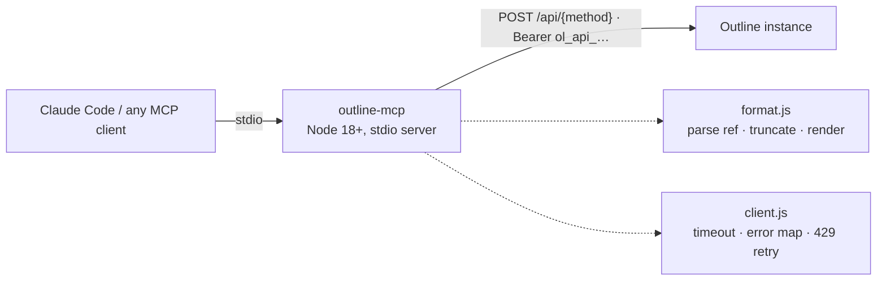

# outline-mcp

Read-only [MCP](https://modelcontextprotocol.io) server for
[Outline](https://www.getoutline.com). Gives an agent search and read access
to your wiki — no writes, by design.

[](LICENSE)
[](https://nodejs.org)

## Why

Outline's API is a flat RPC surface — every endpoint is
`POST {base}/api/<method>` with a JSON body and a Bearer token. That uniformity
means a useful MCP server is a single request function plus a curated tool
list. This package is deliberately small: no runtime
dependency beyond the MCP SDK and zod, and full control over the tool
descriptions and output shaping that determine whether the agent picks the
right tool.

The server is **read-only**: there is no create, update, move, or archive path
anywhere in the code.

## Tools

| Tool | Outline method | Use it for |
|---|---|---|
| `search_documents` | `documents.search` | Full-text search; returns snippets, not bodies |
| `search_document_titles` | `documents.search_titles` | Locate a page you can already almost name |
| `get_document` | `documents.info` | Read one document as markdown |
| `list_collections` | `collections.list` | Find `collectionId` values to scope by |
| `list_documents` | `documents.list` | Browse a collection or a document's children |
| `list_revisions` | `revisions.list` | See how a document changed over time |
| `get_revision` | `revisions.info` | Read one earlier version |
| `list_comments` | `comments.list` | Reviewer pushback not present in the body |

`get_document` accepts a full URL, a bare `urlId`, or a UUID. A `urlId` is
`[A-Za-z0-9]{10,15}` — a slug without a valid id suffix is rejected locally,
because the API answers `400 validation_error` for it.

## Requirements

- Node 18 or newer (uses the built-in `fetch`; no native dependencies).
- An Outline instance — self-hosted or [Outline.com](https://www.getoutline.com).

## Getting started

```bash
git clone https://github.com/minhquan2904/outline-mcp.git
cd outline-mcp
npm ci
```

### Get an API key

In Outline: **Settings → API & Apps → New API key**. The value starts with
`ol_api_` followed by 38 alphanumeric characters.

### Set the two environment variables

```bash
export OUTLINE_API_URL=https://your-outline-instance
export OUTLINE_API_KEY=ol_api_…
node index.js
```

## Configuration

The server reads exactly two environment variables:

| Variable | Meaning |
|---|---|
| `OUTLINE_API_URL` | Base URL of your Outline instance, e.g. `https://your-outline-instance` (a trailing `/api` is tolerated) |
| `OUTLINE_API_KEY` | An Outline API key (`ol_api_…`) |

**Claude Code** — `mcp.json` (project) or `.mcp.json` (user):

```json
{
  "mcpServers": {
    "outline": {
      "command": "node",
      "args": ["/path/to/outline-mcp/index.js"],
      "env": {
        "OUTLINE_API_URL": "https://your-outline-instance",
        "OUTLINE_API_KEY": "ol_api_…"
      }
    }
  }
}
```

**Claude Desktop** — `claude_desktop_config.json`:

```json
{
  "mcpServers": {
    "outline": {
      "command": "node",
      "args": ["/path/to/outline-mcp/index.js"],
      "env": {
        "OUTLINE_API_URL": "https://your-outline-instance",
        "OUTLINE_API_KEY": "ol_api_…"
      }
    }
  }
}
```

**Note:** Claude Desktop does **not** expand `${VAR}` references in this file
— paste the key literally, do not write `"${OUTLINE_API_KEY}"`.

**Any other MCP client** (Zed, Cline, or anything speaking the MCP stdio
protocol) — same shape: launch `node /path/to/outline-mcp/index.js` with the
two variables in its environment.

## How it works



The server never validates credentials at startup. A server that exits on boot
appears in the client as "failed to connect" with no explanation; instead it
starts, lists its tools, and each call returns a message naming the missing
variable.

## Development

```bash
npm ci
npm test          # unit tests, fully offline (fetch is stubbed)
npm run smoke     # every tool against a real instance; no-ops without credentials
```

`npm run smoke` requires `OUTLINE_API_URL` + `OUTLINE_API_KEY` pointing at a
live instance; without them it prints a "smoke skipped" line and exits 0.
See [CONTRIBUTING.md](CONTRIBUTING.md) for how to add a tool.

## Limitations

- **Read-only by design.** No create, update, move, archive, or comment writes.
- **Attachments are not resolved.** Embedded images and files stay as
  `/api/attachments.redirect?id=…` links in the markdown; they will not load for
  an agent reading the text.
- **No proactive rate-limit signal.** The instance does not return `RateLimit-*`
  headers. On a `429` the client honours `Retry-After` (capped at 10s) and
  retries exactly once, then reports the failure.
- Long documents are truncated at `maxChars` (default 40 000) with a marker
  stating the true total length.

## Security

The API key travels only in the `Authorization` header of outgoing requests.
Any error message that leaves the client is passed through a redaction step
that replaces the key with `ol_api_***`, and nothing on the key's path (the
stdio transport or the stderr log) ever prints the key itself. If your Outline
instance supports scoped keys, prefer a read-only-scoped key for this server.

## License

[MIT](LICENSE) — see [LICENSE](LICENSE) for the full text.
